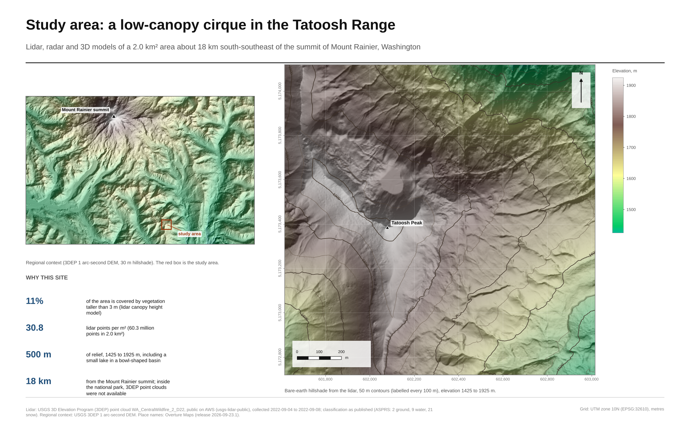
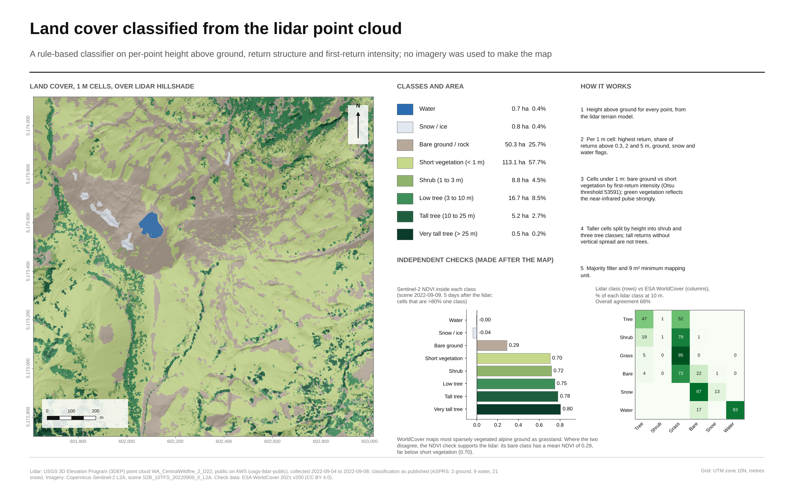
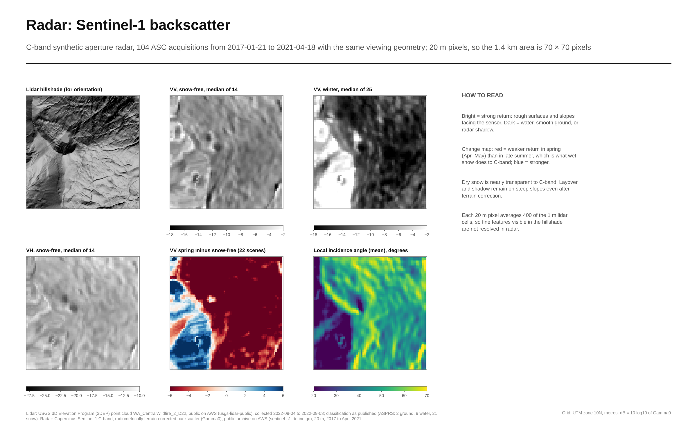
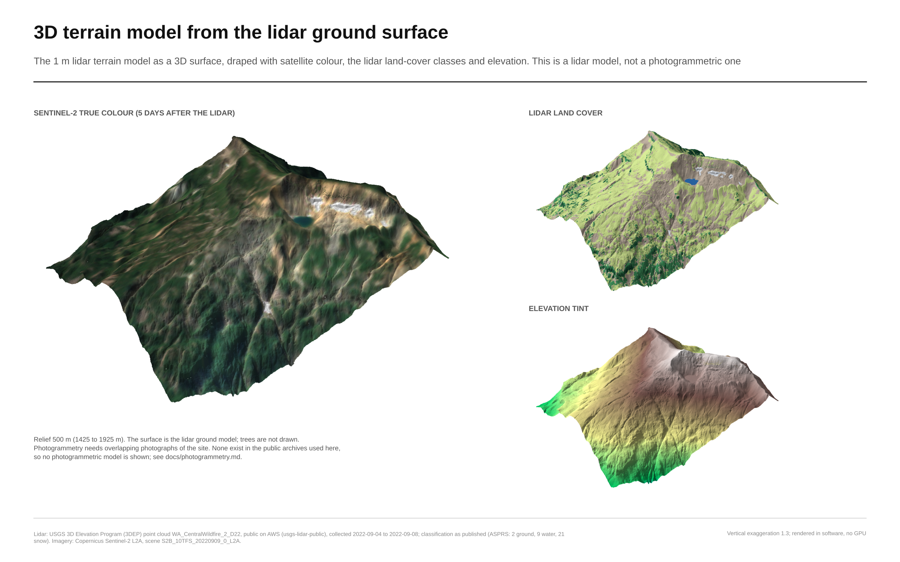
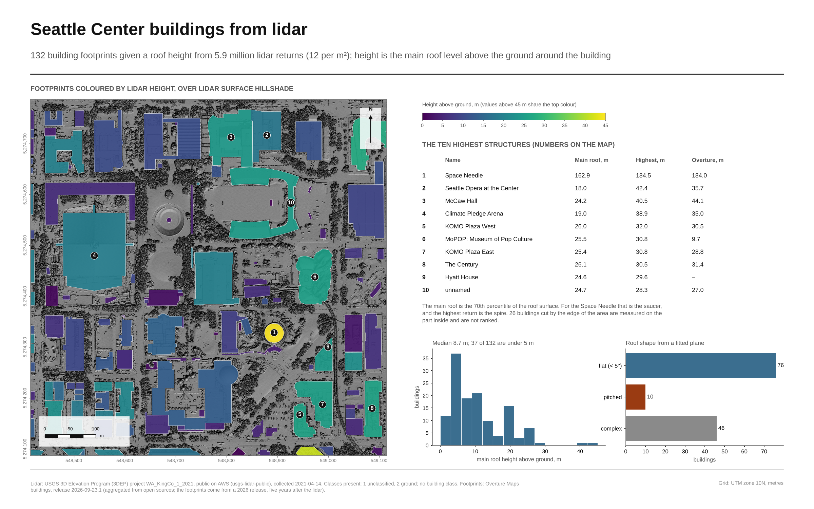
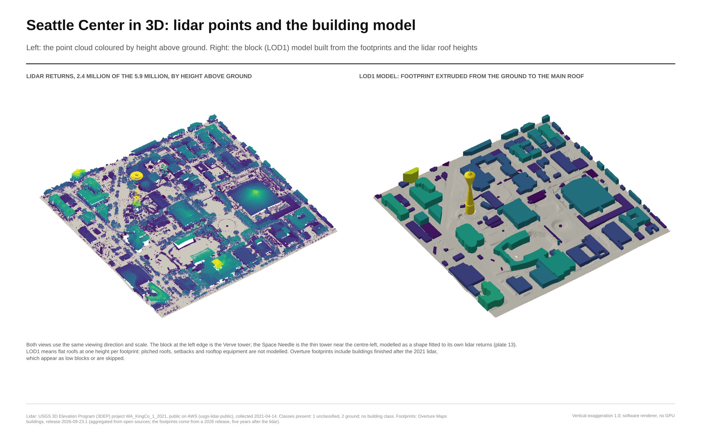
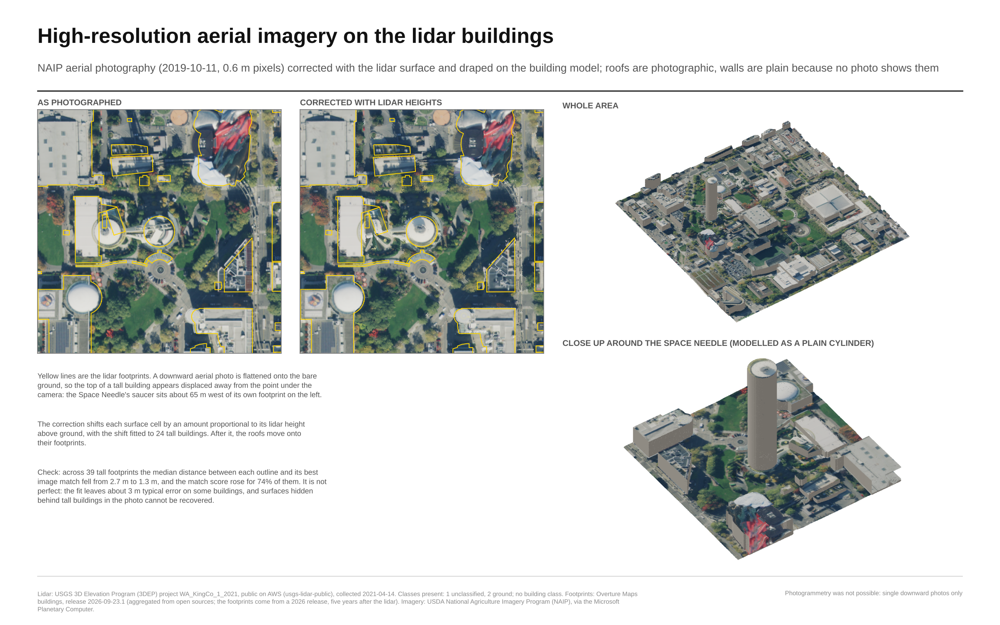

# Lidar and 3D modeling: a low-canopy cirque in the Tatoosh Range, Washington

Lidar, radar and 3D terrain products for a 1.4 km square (2.0 km²) about 18 km south-southeast of the summit of Mount Rainier. Everything is built from public data, by code in this repository, and every number on the plates is computed from that data.



## What is here

| Product | File | What it is |
|---|---|---|
| Study area | [outputs/01_study_area.png](outputs/01_study_area.png) | Location, context, site statistics |
| Terrain | [outputs/02_terrain.png](outputs/02_terrain.png) | 1 m bare-earth model, hillshade, slope, topographic position |
| Point cloud | [outputs/03_point_cloud.png](outputs/03_point_cloud.png) | 60.3 million points, 3D views, density, cross-section |
| Canopy | [outputs/04_canopy.png](outputs/04_canopy.png) | Canopy height model, 6,268 tree tops, tree line |
| **Land cover from lidar** | [outputs/05_land_cover.png](outputs/05_land_cover.png) | Eight classes from the point cloud alone, checked against Sentinel-2 and WorldCover |
| Radar | [outputs/06_radar_maps.png](outputs/06_radar_maps.png) | Sentinel-1 backscatter, snow-free vs winter vs spring melt |
| Radar and lidar | [outputs/07_radar_time_series.png](outputs/07_radar_time_series.png) | Seasonal backscatter by elevation, relation to lidar canopy and slope |
| 3D model | [outputs/08_terrain_model.png](outputs/08_terrain_model.png) | Terrain surface draped with Sentinel-2, land cover, elevation |
| Interactive point cloud | [outputs/point_cloud_viewer.html](outputs/point_cloud_viewer.html) | Standalone viewer, 500,000 points, open in any browser |
| Terrain mesh | `data/processed/terrain_s2_draped.glb` | 4 m triangle mesh with Sentinel-2 vertex colours (122,500 vertices) |
| Point cloud sample | `data/processed/point_cloud_500k.ply` | 500,000 random points, local coordinates, coloured by height class |
| Rasters | `data/processed/*.tif` | 1 m DTM, DSM, canopy height, land-cover class (EPSG:32610) |





## Second analysis: Seattle Center buildings

LOD1 building models for 132 footprints around the Space Needle, from the 2021 King County lidar (12 points per m²) and Overture footprints. Details and numbers in [docs/seattle-buildings.md](docs/seattle-buildings.md).





* [outputs/09_seattle_buildings.png](outputs/09_seattle_buildings.png), [10_seattle_3d.png](outputs/10_seattle_3d.png), [11_seattle_height_check.png](outputs/11_seattle_height_check.png)
* `data/processed/seattle/`: CityJSON, GLB, GeoPackage; [outputs/seattle_point_cloud_viewer.html](outputs/seattle_point_cloud_viewer.html)
* **Aerial imagery:** NAIP 2019 (0.6 m) corrected for relief displacement with the lidar heights and draped on roofs and ground: [outputs/12_seattle_imagery.png](outputs/12_seattle_imagery.png), `seattle_center_textured.glb`.
* Limits: flat-roof blocks only (no LOD2); heights compared with Overture's rather than a survey; imagery is a single downward photo from 2019, so roofs are photographic but walls are plain grey; and **no photogrammetry**: no overlapping photographs of the buildings could be obtained.

## Data

* **Lidar:** USGS 3D Elevation Program project `WA_CentralWildfire_2_D22`, Entwine Point Tiles on AWS (`s3://usgs-lidar-public`). Collected 2022-09-04 to 2022-09-08 (dates derived from the point GPS times). 30.8 points per m². Published classes present: 1 unclassified, 2 ground, 9 water, 20 and 21 snow; there are no vegetation classes, so canopy comes from a height model.
* **Radar:** Sentinel-1 radiometrically terrain-corrected Gamma0, VV and VH, 20 m, from the public `sentinel-s1-rtc-indigo` archive. 104 ascending acquisitions with the same geometry, 2017-01-21 to 2021-04-18.
* **Aerial imagery (Seattle):** USDA NAIP 2019-10-11, 0.6 m, via the Microsoft Planetary Computer.
* **Optical, for checking and draping:** Sentinel-2 L2A scene `S2B_10TFS_20220909` (five days after the lidar).
* **Check data:** ESA WorldCover 2021 v200. Place names: Overture Maps. Regional hillshade: USGS 3DEP 1 arc-second DEM.

## Land cover from the point cloud

The classifier ([src/lidar3d/landcover.py](src/lidar3d/landcover.py)) uses only the lidar: per-point height above ground, return structure per 1 m cell, and first-return intensity. Cells under 1 m split into bare ground and short vegetation by an Otsu threshold on intensity (vegetation reflects the near-infrared pulse strongly). A majority filter and a 9 m² minimum mapping unit finish the map.

Result: bare ground / rock 25.7 %, short vegetation 57.7 %, shrub 4.5 %, low tree 8.5 %, tall tree 2.7 %, very tall tree 0.2 %, water 0.4 %, snow / ice 0.4 %.

Checks made after the map was finished, not used to tune it, except where stated below:

* Mean Sentinel-2 NDVI inside each class rises in the expected order: water 0.00, snow -0.04, bare 0.29, short vegetation 0.70, shrub 0.72, low tree 0.75, tall tree 0.78, very tall tree 0.80.
* Agreement with ESA WorldCover at 10 m is 68 %. Most of the disagreement is WorldCover calling sparsely vegetated alpine ground "grassland" where the lidar and NDVI say bare. This is a disagreement between maps, not a measured accuracy; there is no field data here.
* History, stated plainly: the first version of the classifier labelled 52 % of the area as bare ground. The NDVI check showed that was wrong (mean NDVI 0.60 there), so the bare/short-vegetation split was changed to use intensity. The NDVI check therefore shaped the final design.

## Honest limits

* **Not inside the park.** No dense 3DEP point cloud covering the Mount Rainier National Park interior turned up in the projects checked. The site is the best low-canopy area found in the nearest dense coverage, 18 km from the summit. See [docs/site-selection.md](docs/site-selection.md).
* **No photogrammetric model.** Photogrammetry needs overlapping photographs of the site. None are in the public archives used here, and generating a model from satellite images or from the lidar would not be photogrammetry. The 3D model here is a lidar terrain surface. [docs/photogrammetry.md](docs/photogrammetry.md) shows how to run it on your own photos.
* **Radar is coarse and from a different period.** 20 m pixels (70 × 70 over the area) against 1 m lidar, and the archive ends in April 2021 while the lidar is from September 2022. The radar-lidar comparison is therefore about how the signal relates to terrain and canopy, not a same-day fusion. Correlations: canopy cover vs VH r = 0.30, vs VV r = 0.24, slope vs VV r = 0.04, n = 4,761 pixels. These are weak relationships.
* **Snow.** The reading that spring backscatter dips because of wet snow is an interpretation; no snow-cover data was used to test it.
* **Canopy.** Heights are the highest return per 1 m cell; a boulder or cornice of the same height looks like a tree to the model.
* **Not verified here:** WebGL or GPU rendering (the plates and the point-cloud viewer use a software renderer; the viewer was loaded once in headless Chromium with no errors), opening the GLB and PLY files in specific desktop viewers (they were loaded back with `trimesh` only), and any field validation.

## Correction made on 2026-10-26

The software renderer used for the 3D views drew the farthest point instead of the nearest where points overlapped. It was found while rendering buildings, fixed in `render3d.py`, covered by a test, and the Rainier point-cloud views (plate 03), the 3D model plate and the viewers were rebuilt. Earlier versions of those images showed far-side surfaces through near ones.

## Run it

```bash
pip install -r requirements.txt
python scripts/build_all.py            # fetches data on first run (about 1.4 GB of lidar tiles, cached in data/cache), rebuilds figures and exports
python scripts/build_all.py figures    # or: exports
python scripts/build_seattle.py        # Seattle Center buildings
python -m pytest tests                 # pure-logic tests, no network
```

`src/lidar3d`: `ept.py` reads the EPT index and tiles, `cloud.py` and `products.py` build the terrain and canopy rasters and the statistics, `landcover.py` classifies, `radar.py` and `imagery.py` read Sentinel data, `validate.py` runs the checks, `figures.py` and `plates.py` draw the plates, `exports.py` writes the mesh, point cloud and viewer.
