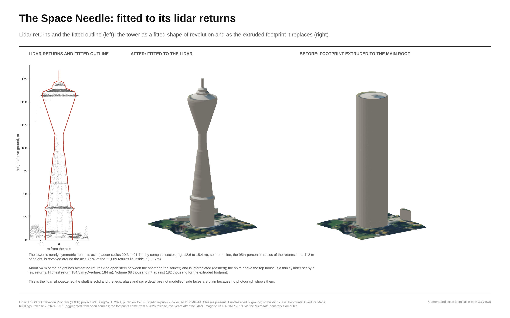
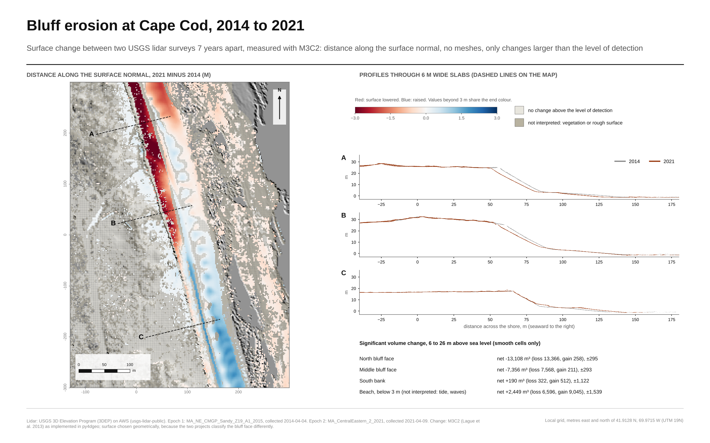
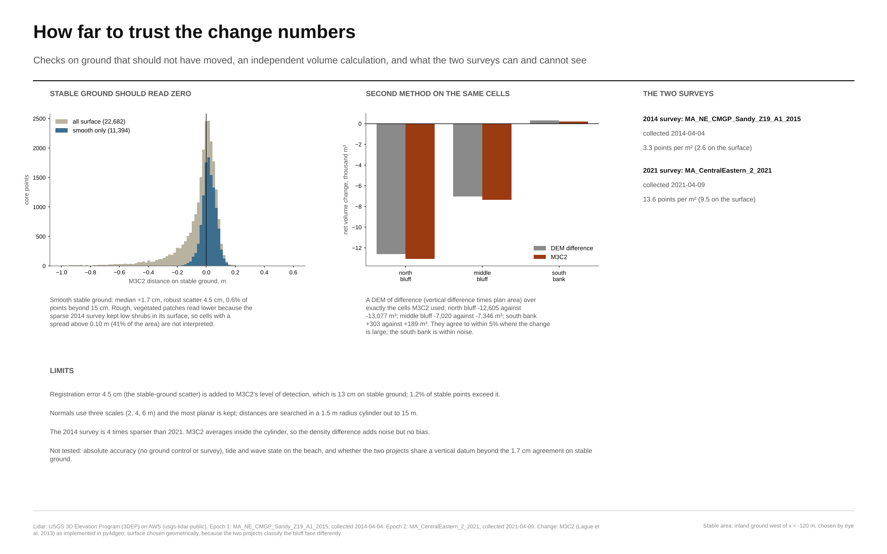
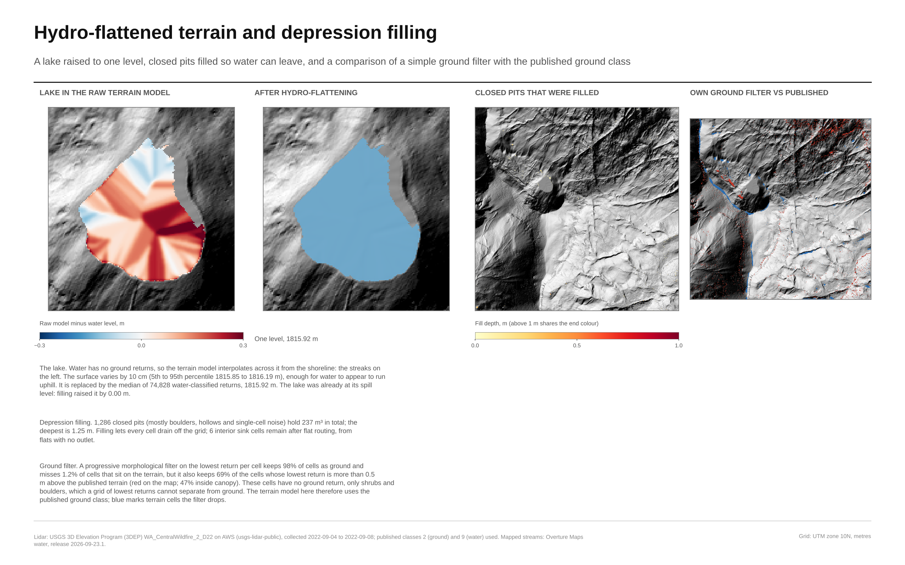
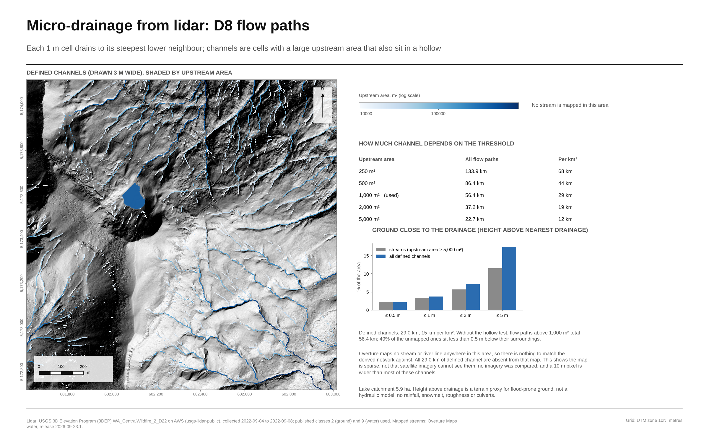
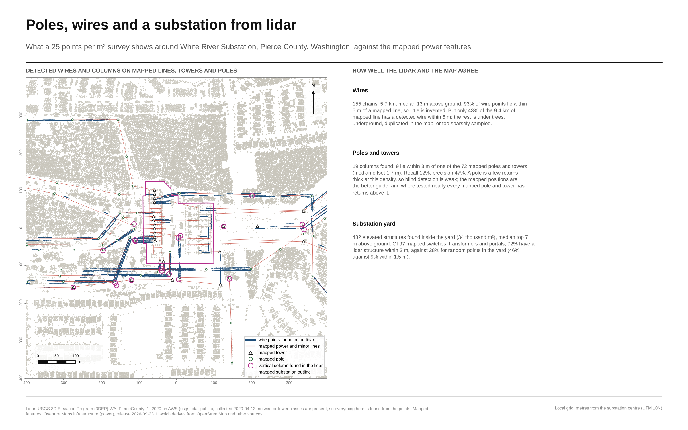
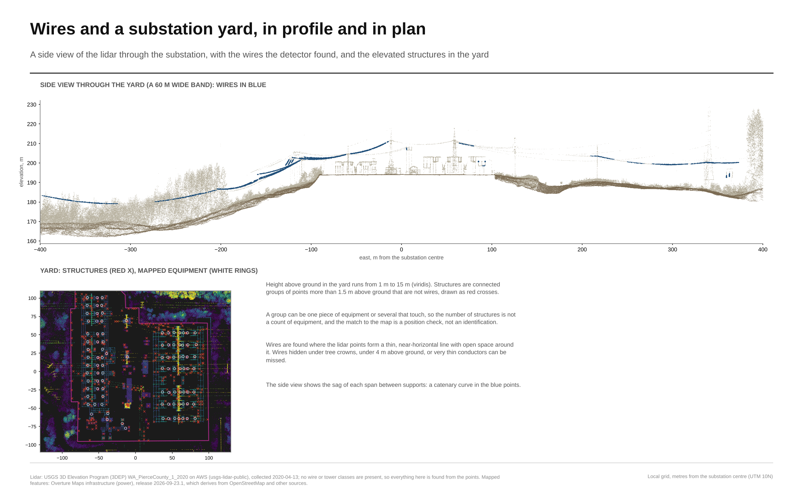

# Lidar and 3D modeling: a low-canopy cirque in the Tatoosh Range, Washington

Lidar, radar and 3D terrain products for a 1.4 km square (2.0 km²) about 18 km south-southeast of the summit of Mount Rainier. Everything is built from public data, by code in this repository, and every number on the plates is computed from that data.


## What is here

| Product | File | What it is |
|---|---|---|
| Study area | [outputs/01_study_area.png](outputs/01_study_area.png) | Location, context, site statistics |
| Terrain | [outputs/02_terrain.png](outputs/02_terrain.png) | 1 m bare-earth model, hillshade, slope, topographic position |
| Point cloud | [outputs/03_point_cloud.png](outputs/03_point_cloud.png) | 60.3 million points, 3D views, density, cross-section |
| Canopy | [outputs/04_canopy.png](outputs/04_canopy.png) | Canopy height model, 6,268 tree tops, tree line |
| **Land cover from lidar** | [outputs/05_land_cover.png](outputs/05_land_cover.png) | Eight classes from the point cloud alone, checked against Sentinel-2 and WorldCover |
| Radar | [outputs/06_radar_maps.png](outputs/06_radar_maps.png) | Sentinel-1 backscatter, snow-free vs winter vs spring melt |
| Radar and lidar | [outputs/07_radar_time_series.png](outputs/07_radar_time_series.png) | Seasonal backscatter by elevation, relation to lidar canopy and slope |
| 3D model | [outputs/08_terrain_model.png](outputs/08_terrain_model.png) | Terrain surface draped with Sentinel-2, land cover, elevation |
| Interactive point cloud | [outputs/point_cloud_viewer.html](outputs/point_cloud_viewer.html) | Standalone viewer, 500,000 points, open in any browser |
| Terrain mesh | `data/processed/terrain_s2_draped.glb` | 4 m triangle mesh with Sentinel-2 vertex colours (122,500 vertices) |
| Point cloud sample | `data/processed/point_cloud_500k.ply` | 500,000 random points, local coordinates, coloured by height class |
| Rasters | `data/processed/*.tif` | 1 m DTM, DSM, canopy height, land-cover class (EPSG:32610) |


## Second analysis: Seattle Center buildings

Building models for the 700 m square around the Space Needle (0.49 km²), from the 2021 King County lidar (5.9 million points, 12 per m²), Overture Maps footprints and USDA NAIP aerial imagery. 132 of 139 footprints were measured. Most are flat-roof (LOD1) blocks at the lidar roof height; the Space Needle is fitted to its own lidar returns; 25 curved or stepped roofs follow their lidar surface in the textured model. Method, numbers and limits: [docs/seattle-buildings.md](docs/seattle-buildings.md).




| Product | File | What it is |
|---|---|---|
| Buildings by height | [outputs/09_seattle_buildings.png](outputs/09_seattle_buildings.png) | Footprints coloured by lidar height, the ten highest structures, height and roof-shape distributions |
| 3D views | [outputs/10_seattle_3d.png](outputs/10_seattle_3d.png) | Lidar points by height above ground, and the block model |
| Height check | [outputs/11_seattle_height_check.png](outputs/11_seattle_height_check.png) | Lidar heights against Overture's, largest differences |
| Aerial imagery on the models | [outputs/12_seattle_imagery.png](outputs/12_seattle_imagery.png) | NAIP 2019 corrected with the lidar heights, before and after, draped in 3D |
| Space Needle | [outputs/13_space_needle.png](outputs/13_space_needle.png) | Shape of revolution fitted to its returns; about 54 m of height is interpolated |
| Curved roof | [outputs/14_mopop_curved_roof.png](outputs/14_mopop_curved_roof.png) | Museum of Pop Culture: the roof follows its lidar surface under the photo (the red is the real roof colour) |
| Building model | `data/processed/seattle/seattle_center_lod1.city.json` | CityJSON 1.1: LOD1 blocks, the Space Needle as an LOD2 solid |
| Textured model | `data/processed/seattle/seattle_center_textured.glb` | Photo on roofs and ground; curved roofs in 3D |
| Block model | `data/processed/seattle/seattle_center_lod1.glb` | Terrain and blocks coloured by height |
| Measurements | `data/processed/seattle/buildings_lod1.gpkg` | Footprints with ground, roof and maximum heights, roof shape |
| Corrected imagery | `data/processed/seattle/naip_2019_lidar_corrected.tif` | NAIP re-sampled with lidar heights, R, G, B, NIR, EPSG:32610 |
| Point cloud | [outputs/seattle_point_cloud_viewer.html](outputs/seattle_point_cloud_viewer.html) | 600,000 points, standalone viewer |

Limits: roofs are flat blocks except the Space Needle and the curved roofs, and the CityJSON keeps all but the Needle as LOD1; heights are compared with Overture's, not with a survey; the imagery is a single downward photo from 2019, so roofs are photographic and walls are plain grey (curved roofs take their roof edge's colour); and there is **no photogrammetry**, because no overlapping photographs of the buildings could be obtained.

## Third analysis: coastal bluff erosion at Cape Cod (4D change detection)

Two USGS 3DEP lidar surveys of the same bluff, April 2014 and April 2021, compared with M3C2 (distance along the surface normal, no meshes) using `py4dgeo`. The north bluff face lost about 73 m³ per metre of shore over 7 years; stable inland ground reads +1.7 cm with 4.5 cm scatter, and an independent DEM-of-difference volume agrees within 5 %. Vegetated and rough surface (41 % of the area) is excluded, the beach is not interpreted, and CloudCompare itself was not used. Method, numbers and limits: [docs/coastal-erosion.md](docs/coastal-erosion.md).




Run `python scripts/build_change.py`. Outputs (`data/processed/capecod/`): core points CSV and PLY, a 2 m change raster, `stats.json`.

## Fourth analysis: hydro-flattened terrain and micro-drainage (D8)

The Tatoosh cirque terrain with its lake flattened to one level, 1,286 closed pits filled and a D8 flow network on the 1 m surface. Defined channels total 29.0 km (15 km per km²); the map data used has no stream line in the area at all. A simple ground filter is compared with the published ground class and not used, because it keeps 69% of the shrub and boulder cells that have no ground return. Flood-prone ground is a height-above-drainage proxy, not a flood model. Method, numbers and limits: [docs/hydrology.md](docs/hydrology.md).




Run `python scripts/build_hydro.py`. Outputs in `data/processed/hydro/`: hydro-flattened and filled DEMs, flow accumulation, D8 directions, `stats.json`.

## Fifth item: utility data search (3DEP lidar with power features)

A search for 3DEP projects that cover Overture-mapped substations, powerlines, towers and poles. Nine projects, 36 sites probed. Wire and tower lidar classes (14, 15) are absent everywhere, but poles and towers show up as columns of returns above their mapped positions. Candidate sites include Pierce County WA, southern New Jersey, Dighton MA and San Francisco. Method, table and limits: [docs/utilities-data-search.md](docs/utilities-data-search.md). Data: `data/processed/utilities/`. Run `python scripts/search_utilities.py`.

## Sixth item: poles, wires and a substation from lidar (White River, WA)

At the best site from the search, wires, vertical columns and substation structures were found from the points (no wire or tower classes exist) and compared with Overture's mapped features. 155 wire chains (5.7 km), 93% of them on mapped lines; blind pole detection is weak (12% recall); the yard's mapped equipment sits at lidar structures 72% of the time against 28% for random points. Method, numbers and limits: [docs/utility-extraction.md](docs/utility-extraction.md).




Run `python scripts/build_utility.py`. Outputs in `data/processed/utility/`.

## Seventh item: fusing lidar, imagery and radar for lines and poles, checked against OpenStreetMap

Broken wire fragments are joined into conductors and gaps are filled with fitted sag curves; supports come from the wires' height peaks and a signed-score fusion of lidar, NAIP imagery and Sentinel-1 radar. OpenStreetMap (via Overture Maps) is used only afterwards, as the check.
Lidar carries the signal (AUC 0.81 against mapped supports); imagery and radar add nothing measurable at this site, and gap filling adds only 0.6 points of line coverage but is accurate. 39% of mapped line length is confirmed, 11% has no lidar evidence (all 230 kV, likely a detector limit).
Plates 22 to 24, method and numbers in [docs/fusion-model.md](docs/fusion-model.md). Run `python scripts/build_fusion.py`.

## Eighth item: wires fitted between supports, and a 3D scene

Instead of growing wires from fragments, every pair of nearby anchors is tested for a wire (straight in plan, parabolic in height) and accepted spans are completed from the fitted curve: 620 wires, 32 km, 80% observed, about 10% false length on a shifted-data test, and a hidden-stretch test that puts the filled height within 4 cm (a straight line is off by 24 cm over 40 m).
Supports are where wires end with no wire passing over (59, 17 of 44 outside the yard within 5 m of a mapped tower or pole). A 3D scene shows lattice towers, poles, cross-arms, insulators and wires over lidar coloured from NAIP imagery, with GLB files and an interactive viewer in `outputs/utility3d/`.
Plates 25 to 27, method and limits in [docs/span-model.md](docs/span-model.md). Run `python scripts/build_spans.py` then `python scripts/build_spans_3d.py`.

## Ninth item: scroll bars of a meandering river from one lidar flight (Wabash, Illinois)

No repeat lidar is needed to map the ridges a migrating bend leaves behind: one 2011 flight gives 144 crest and 128 swale lines (median crest relief 33 cm; neighbouring crests 58 m apart on the point bar, 72 m on the older arcs north of the river). Tests: DEM hold-out error 5.3 cm (3 cm on flat ground), flight-line agreement 2 to 6 cm, planted-ridge detection (5 cm ridges found 99% with white noise, 73% with correlated error; 8 cm 96%), and repeatability between independent halves of the returns (about 90%).
NAIP imagery from 2011 to 2023 could not give a reliable migration rate (the rate changes sign when one year is dropped), so no ridge ages are claimed. Plates 28 to 31, method and limits in [docs/meander-scroll-bars.md](docs/meander-scroll-bars.md). Run `python scripts/build_meander.py`.

## Tenth item: canopy structure and fragmentation (NW Houston and a Sierra conifer forest)

An automated pipeline turns 3DEP lidar into terrain, surface and canopy height models, individual trees, tree density, canopy openings and fragmentation metrics, with GeoTIFFs, a tree table and an interactive map per site. NW Houston (Cypress, 225 ha): 44% canopy, 3,206 patches, 56% open, mostly in large openings. Forest north of Truckee (100 ha): 60% canopy, one patch holding 51% of the area, taller (mean tree 22 m) and denser. Each site has a site map locating it in its region, state and imagery.
Tests: terrain error 3 to 6 cm, planted trees recovered (89% and 72% at 100 per ha, falling in crowded stands: counts are lower bounds), thinning of returns, resolution sensitivity (cover changes by 20 points between 0.5 and 2 m cells) and a NAIP check. Connectivity (plates 37, 38): at a 3 m gap the largest cluster holds 86% (Houston) and 96% (Tahoe) of patch canopy, and 75% and 92% of canopy is reachable through stepping stones; Houston's figure swings from 30% to 93% with mapping choices, Tahoe's stays 81 to 97%. Plates 32 to 38, method in [docs/canopy-structure.md](docs/canopy-structure.md). Run `python scripts/build_canopy.py all` then `python scripts/plot_canopy.py`.

## Eleventh item: rooftop solar potential (West University Place and downtown Houston)

Roofs are found from lidar by shape (the project's building class also holds tree returns), split into planes by RANSAC, shaded by the surrounding buildings and trees, and summed over an NREL typical year. West U: 104 buildings, 45 GWh a year on the roofs (1,198 kWh/m2), 23% of direct sun lost to shade, south-facing roofs 1,308 against 948 for north-facing; downtown: 55% of direct sun lost to shade, 27% of roof area above 1,000 kWh/m2. Sun geometry matches pvlib; planted roofs recover slope to 0.4 degrees (95th percentile); but totals move about 10% with the shading surface, and roofs under trees are missing.
A notebook ([notebooks/rooftop_solar.ipynb](notebooks/rooftop_solar.ipynb)) takes any longitude/latitude box and writes a `.glb` and `.obj` plus per-rooftop kWh/year plots. Plates 39 to 45, method and limits in [docs/rooftop-solar.md](docs/rooftop-solar.md).

## Twelfth item: topographic differencing, Pacifica bluffs (2010, 2016, 2023)

Three lidar surveys of the Pacifica bluffs and Mori Point, registered on stable ground (ICP), differenced to DEMs of difference with a slope-dependent level of detection, M3C2 on the bluff face, cut-and-fill volumes, and contour retreat. In the 60 m coastal band 2016 to 2023 lowered 33,078 m3 and raised 7,669 m3 (net -25,409 m3), against net -2,670 m3 for 2010 to 2016; the 12 m contour on the face retreated a median 0.8 m in 2016 to 2023 with a few stretches retreating over 3 m.
Tests: held-out registration (helps 2016, not the sparse 2010 survey), 95% level of detection 7 to 14 cm on flat ground and about 30 cm on steep slopes, planted 10 cm steps recovered within 4%, M3C2 and DEM of difference agree per cell at r = 0.77 but differ in face total (14.7k against 22.8k m3), closure within 6%. No field validation was available. Plates 46 to 50, method and limits in [docs/topographic-differencing.md](docs/topographic-differencing.md). Run `python scripts/build_topodiff.py` then `python scripts/plot_topodiff.py`.

## Thirteenth item: drainage and flood-stage road vulnerability (Norfolk, Virginia)

A 1 m bare-earth terrain from 2013 lidar (4.5 cm held-out error; 4.1 cm robust spread against USGS's own DTM; overlapping flight lines agree to 3 to 4 cm), conditioned with pysheds into flow paths and 75 closed depressions, 10 of them held back by road embankments (culvert candidates; planted embankments of 0.5 m or more are found 67 to 88% of the time, never when a culvert is open). A static bathtub at stages 1.5 to 4.0 m floods 3 ha at 1.5 m, 27 ha at 2.5 m and 122 ha at 3 m. Roads are no longer assumed safe because something is overhead: each segment is classified from the map tags and from what the lidar sees along it, so underpass and tree-lined streets flood and only decks above the water (2 bridge segments) and unseen tunnel floors are exempt. With 30 cm of water, 25 km of the 51 km of drivable roads are out of use at 2.5 m if every low spot floods (22 to 30 km allowing for a 13 cm lidar error), 39 km at 3 m; the connected network falls to 12% of its length at 3 m. A 10 cm error in the stage moves the 2.5 m flooded area from 24 to 53 ha. No tide, storm, drain or observed flood extent is used or checked. The no-return voids that supply the water do not match mapped water, so the connected scenario is a scenario, not a measured tidal link.
Plates 51 to 55, method and limits in [docs/flood-drainage.md](docs/flood-drainage.md). Run `python scripts/build_flood.py` then `python scripts/plot_flood.py`.

## Data

* **Lidar:** USGS 3D Elevation Program project `WA_CentralWildfire_2_D22`, Entwine Point Tiles on AWS (`s3://usgs-lidar-public`). Collected 2022-09-04 to 2022-09-08 (dates derived from the point GPS times). 30.8 points per m². Published classes present: 1 unclassified, 2 ground, 9 water, 20 and 21 snow; there are no vegetation classes, so canopy comes from a height model.
* **Radar:** Sentinel-1 radiometrically terrain-corrected Gamma0, VV and VH, 20 m, from the public `sentinel-s1-rtc-indigo` archive. 104 ascending acquisitions with the same geometry, 2017-01-21 to 2021-04-18.
* **Seattle lidar:** USGS 3DEP `WA_KingCo_1_2021`, collected 2021-04-14, 12 points per m², classes 1 and 2 only (no building class). **Footprints:** Overture Maps buildings, release 2026-09-23.1. **Aerial imagery:** USDA NAIP 2019-10-11, 0.6 m, via the Microsoft Planetary Computer.
* **Cape Cod change:** USGS 3DEP `MA_NE_CMGP_Sandy_Z19_A1_2015` (flown 2014-04-04) and `MA_CentralEastern_2_2021` (2021-04-09).
* **Optical, for checking and draping:** Sentinel-2 L2A scene `S2B_10TFS_20220909` (five days after the lidar).
* **Check data:** ESA WorldCover 2021 v200. Place names: Overture Maps. Regional hillshade: USGS 3DEP 1 arc-second DEM.

## Land cover from the point cloud

The classifier ([src/lidar3d/landcover.py](src/lidar3d/landcover.py)) uses only the lidar: per-point height above ground, return structure per 1 m cell, and first-return intensity. Cells under 1 m split into bare ground and short vegetation by an Otsu threshold on intensity (vegetation reflects the near-infrared pulse strongly). A majority filter and a 9 m² minimum mapping unit finish the map.

Result: bare ground / rock 25.7 %, short vegetation 57.7 %, shrub 4.5 %, low tree 8.5 %, tall tree 2.7 %, very tall tree 0.2 %, water 0.4 %, snow / ice 0.4 %.

Checks made after the map was finished, not used to tune it, except where stated below:

* Mean Sentinel-2 NDVI inside each class rises in the expected order: water 0.00, snow -0.04, bare 0.29, short vegetation 0.70, shrub 0.72, low tree 0.75, tall tree 0.78, very tall tree 0.80.
* Agreement with ESA WorldCover at 10 m is 68 %. Most of the disagreement is WorldCover calling sparsely vegetated alpine ground "grassland" where the lidar and NDVI say bare. This is a disagreement between maps, not a measured accuracy; there is no field data here.
* History, stated plainly: the first version of the classifier labelled 52 % of the area as bare ground. The NDVI check showed that was wrong (mean NDVI 0.60 there), so the bare/short-vegetation split was changed to use intensity. The NDVI check therefore shaped the final design.

## Accuracy against independent data

Every analysis is checked against something it did not produce (a second survey, overlapping flight lines, USGS's own DTM, satellite and third-party maps, null tests); the table, what each check changed and what is still unchecked are in [docs/accuracy-assessment.md](docs/accuracy-assessment.md). Run the `scripts/validate_*.py` scripts, then `python scripts/build_accuracy_report.py`.

## Honest limits

* **Not inside the park.** No dense 3DEP point cloud covering the Mount Rainier National Park interior turned up in the projects checked. The site is the best low-canopy area found in the nearest dense coverage, 18 km from the summit. See [docs/site-selection.md](docs/site-selection.md).
* **No photogrammetric model.** Photogrammetry needs overlapping photographs of the site. None are in the public archives used here, and generating a model from satellite images or from the lidar would not be photogrammetry. The 3D model here is a lidar terrain surface. [docs/photogrammetry.md](docs/photogrammetry.md) shows how to run it on your own photos.
* **Radar is coarse and from a different period.** 20 m pixels (70 × 70 over the area) against 1 m lidar, and the archive ends in April 2021 while the lidar is from September 2022. The radar-lidar comparison is therefore about how the signal relates to terrain and canopy, not a same-day fusion. Correlations: canopy cover vs VH r = 0.30, vs VV r = 0.24, slope vs VV r = 0.04, n = 4,761 pixels. These are weak relationships.
* **Snow.** The reading that spring backscatter dips because of wet snow is an interpretation; no snow-cover data was used to test it.
* **Canopy.** Heights are the highest return per 1 m cell; a boulder or cornice of the same height looks like a tree to the model.
* **Not verified here:** WebGL or GPU rendering (the plates and the point-cloud viewer use a software renderer; the viewer was loaded once in headless Chromium with no errors), opening the GLB and PLY files in specific desktop viewers (they were loaded back with `trimesh` only), and any field validation.

## Correction made on 2026-10-26

The software renderer used for the 3D views drew the farthest point instead of the nearest where points overlapped. It was found while rendering buildings, fixed in `render3d.py`, covered by a test, and the Rainier point-cloud views (plate 03), the 3D model plate and the viewers were rebuilt. Earlier versions of those images showed far-side surfaces through near ones.

## Run it

```bash
pip install -r requirements.txt
python scripts/build_all.py            # fetches data on first run (about 1.4 GB of lidar tiles, cached in data/cache), rebuilds figures and exports
python scripts/build_all.py figures    # or: exports
python scripts/build_seattle.py        # Seattle Center buildings
python scripts/build_change.py         # Cape Cod bluff change (M3C2)
python scripts/build_hydro.py          # hydro-flattening and D8 drainage
python scripts/search_utilities.py     # utility candidate sites
python scripts/build_utility.py        # wires, poles and substation structures at White River
python -m pytest tests                 # pure-logic tests, no network
```

`src/lidar3d`: `ept.py` reads the EPT index and tiles, `cloud.py` and `products.py` build the terrain and canopy rasters and the statistics, `landcover.py` classifies, `radar.py` and `imagery.py` read Sentinel data, `validate.py` runs the checks, `figures.py` and `plates.py` draw the plates, `exports.py` writes the meshes, CityJSON, point clouds and viewers, `render3d.py` is the software renderer. Cape Cod change: `change.py` selects surfaces, runs M3C2 and the checks, `figures_change.py` draws plates 15 and 16. Hydrology: `hydro.py` (ground filter, hydro-flattening, filling, D8, HAND), `figures_hydro.py` draws plates 18 and 19. Seattle buildings: `city.py` fetches the cloud and footprints, `buildings.py` measures them, `needle.py` fits the Space Needle, `naip.py` fetches and corrects the aerial imagery, `figures_city.py` draws plates 09 to 14.
